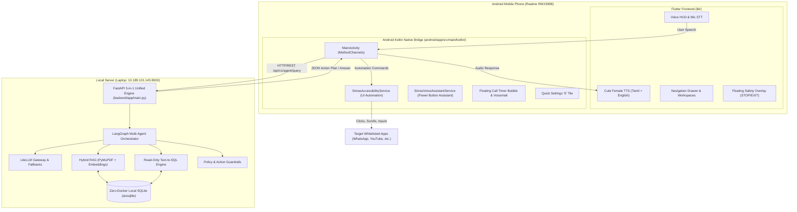

# SINRAS PRO AI — Complete A-to-Z Project Guide & Technical Architecture

**SINRAS PRO AI** is an advanced, JARVIS-grade multi-agent autonomous Android OS assistant that bridges a **Flutter + Android Kotlin** mobile client with a high-performance **5-in-1 FastAPI Python** backend brain.

---

## Section 1: System Architecture Overview

### 1.1 High-Level Architecture Diagram



### 1.2 Data & Control Flow
1. **Trigger & Perception:** The user triggers SINRAS PRO AI via long-pressing the hardware Power button, tapping the Quick Settings `S` tile, or speaking directly into the Flutter Voice HUD.
2. **Security & Whitelist Validation:** Kotlin and Flutter verify whether the requested operation involves a whitelisted app in **Allowed Apps** and asserts that no protected banking or UPI applications (e.g., Google Pay, PhonePe, Paytm) are touched.
3. **Brain Reasoning:** The voice/text command is transmitted over local Wi-Fi to `http://10.189.101.145:8000`. The FastAPI backend processes the request through LangGraph, LiteLLM, and RAG/SQL tools.
4. **Human-in-the-Loop Voice Gate:** If an irreversible or external action is planned (e.g., sending a WhatsApp message), the cute female voice reads back the recipient, message text, and target app, pausing for the user's explicit voice confirmation (`"Yes"` / `"சரி அனுப்பு"`).
5. **Execution:** Upon confirmation, `SinrasAccessibilityService` navigates, finds the exact UI elements, types text, and dispatches the action without requiring root access.

---

## Section 2: Complete A-to-Z Features Breakdown

### A. Voice & Multimodal Interface
* **Voice-First Input:** Real-time Speech-to-Text (STT) powered by speech recognition with ambient noise tolerance and a collapsible text box for quiet environments.
* **Cute Female Voice Persona (Tamil + English):** High-clarity, expressive Text-to-Speech (TTS) synthesized via Android's local TTS engine, handling code-switching between Tamil and English gracefully.
* **Workspace Navigation Drawer:**
  * **New Chat / Voice HUD:** Minimalist pulsing orb interface displaying listening, thinking, and speaking states.
  * **Chat History:** Searchable, persistent conversation sessions stored locally and synced with backend chat history endpoints.
  * **Media & Documents / Tools:** Direct document uploads (.pdf, .docx, .txt) for on-the-fly RAG extraction and call recording review.
  * **Settings Security Hub:** Granular permission switches, server IP endpoint configuration, and status indicators.

### B. Smart Floating Call Timer Bubble & Voicemail Engine
* **Silent & DND Interception:** Detects incoming calls even when the phone is on Silent or Do Not Disturb.
* **Three Responsive Gesture Modes:**
  1. **No Touch (Default Countdown):** Displays a floating countdown bubble over the lock screen / active window. At **5 seconds before timeout**, SINRAS auto-answers the call, greets the caller (*"Sorry, they are currently unavailable..."*), and records their voice message.
  2. **Single Tap:** Instantly disables SINRAS AI for that specific call, allowing the device to ring normally until manually answered or disconnected.
  3. **Long Press (Deep Tap):** Immediately bypasses the timer and instructs SINRAS to answer the call instantly.
* **Storage & Smart Triage:** Call recordings are saved directly into the device's default `Call Recordings` directory. The AI transcribes the message, evaluates importance, and sends an English summary with the caller's phone number directly to the Android Notification Bar.

### C. Universal Device & App Automation
* **`SinrasAccessibilityService`:** Accessibility node tree inspection engine that traverses views, scrolls lists, finds action nodes, clicks buttons, and injects text into any whitelisted third-party app (WhatsApp, YouTube, Instagram, Browser, Contacts).
* **Hardware Controls:** Voice control toggles for Wi-Fi, Bluetooth, Mobile Data, Flashlight, and Volume levels.
* **Quick Settings `'S'` Tile:** System notification shade toggle to enable or disable SINRAS AI background monitoring instantly.
* **Default Digital Assistant (`ACTION_VOICE_INPUT_SETTINGS`):** Seamless integration as the device's primary Voice Interaction Service, capturing long-press Power button events directly.

### D. Zero-Trust Security & Guardrails
* **Allowed Apps Whitelist (`Settings ➔ Allowed Apps`):** Queries `PackageManager` for installed launchable packages, providing individual switches. SINRAS strictly refuses to inspect or automate any app that is not toggled ON.
* **Strict Banking & UPI Lockdown:** Hardcoded blacklist permanently prohibiting interaction with financial applications (Google Pay, PhonePe, Paytm, BHIM, and banking clients). These packages cannot be toggled ON even intentionally.
* **Always-On Floating Safety Overlay:** A top-level system window (`TYPE_APPLICATION_OVERLAY`) rendering `EXIT / STOP / PAUSE` buttons that instantly terminate any executing accessibility task.
* **Confirm-Before-Send Voice Gate:** Sensitive tasks require verbal confirmation before execution, ensuring the user always has final control over outbound messages and actions.

### E. 5-in-1 Backend Stack & Zero-Docker Database
* **LangGraph Multi-Agent Orchestrator:** State machine coordinating multi-step planning, tool selection, and state persistence.
* **LiteLLM Gateway:** Universal model router with transparent fallbacks, streaming support, and cost controls.
* **Hybrid RAG & Read-Only Text-to-SQL:** PyMuPDF document ingestion paired with vector similarity search for unstructured documents, alongside strict `SELECT`-only SQL generation for structured data.
* **Dual SQLite / PostgreSQL Compatibility:** Configured in `backend/app/models.py` to seamlessly operate in zero-Docker local SQLite mode (`sqlite+aiosqlite:///./synras_local.db`) with native JSON embeddings, or switch to PostgreSQL + pgvector in cloud production environments.

---

## Section 3: Step-by-Step A-to-Z Setup & Deployment Guide

### Step 1: Laptop Backend Setup (Windows)

1. **Verify Python 3.12:**
   - Ensure Python 3.12 is installed and added to your system `PATH`:
     ```powershell
     python --version
     # Output: Python 3.12.x
     ```
2. **Configure Environment Variables:**
   - Open [`backend/.env`](file:///C:/Users/muham/StudioProjects/synrasAI/backend/.env) and set your Gemini API key:
     ```env
     DATABASE_URL=sqlite+aiosqlite:///./synras_local.db
     GEMINI_API_KEY=your_actual_gemini_api_key_here
     JWT_SECRET_KEY=c391741584db22fc57c2a71bf6db2ebaf81c9c57d77a0b5a3eb175b5b045e0f7
     ```
3. **Initialize Virtual Environment & Install Dependencies:**
   ```powershell
   cd C:\Users\muham\StudioProjects\synrasAI\backend
   python -m venv .venv
   .\.venv\Scripts\activate
   pip install --default-timeout=1000 -r requirements.txt
   ```
4. **Launch the FastAPI Server:**
   ```powershell
   .\.venv\Scripts\python.exe -m uvicorn app.main:app --host 0.0.0.0 --port 8000
   ```
   *(Verify by opening `http://localhost:8000/health` in your browser. It should return `{"status": "ok", ...}`).*

5. **Identify Your Wi-Fi Local IP Address:**
   - Run `ipconfig` in PowerShell and locate your Wi-Fi IPv4 address (e.g., `10.189.101.145`).

---

### Step 2: Mobile App Build & Connection

1. **NDK & Gradle Configuration:**
   - AGP 9 requires NDK `28.2.13676358` configured in [`android/app/build.gradle.kts`](file:///C:/Users/muham/StudioProjects/synrasAI/android/app/build.gradle.kts).
   - Ensure subproject compileSdk compatibility is enabled in [`android/build.gradle.kts`](file:///C:/Users/muham/StudioProjects/synrasAI/android/build.gradle.kts).
2. **Build the Debug APK:**
   ```powershell
   cd C:\Users\muham\StudioProjects\synrasAI
   flutter build apk --debug
   ```
   - Generated binary location: [`build/app/outputs/flutter-apk/app-debug.apk`](file:///C:/Users/muham/StudioProjects/synrasAI/build/app/outputs/flutter-apk/app-debug.apk).
3. **Install on Connected Phone:**
   ```powershell
   adb -s adb-SWPZMBOBO79PAM5L-7NQTzd._adb-tls-connect._tcp push build/app/outputs/flutter-apk/app-debug.apk /data/local/tmp/app-debug.apk
   adb -s adb-SWPZMBOBO79PAM5L-7NQTzd._adb-tls-connect._tcp shell pm install -r /data/local/tmp/app-debug.apk
   adb -s adb-SWPZMBOBO79PAM5L-7NQTzd._adb-tls-connect._tcp shell rm /data/local/tmp/app-debug.apk
   ```

---

### Step 3: Phone App Configuration

1. Launch **SINRAS PRO AI** on your mobile phone.
2. Navigate to **Menu Bar (☰) ➔ Settings**.
3. Under **Server URL**, enter:
   ```text
   http://10.189.101.145:8000
   ```
   and tap **Save**.
4. Enable the following Android permissions in Settings:
   - **Display Over Other Apps (`SYSTEM_ALERT_WINDOW`)**: For the floating safety overlay and call bubble.
   - **Accessibility Service**: Turn ON **SINRAS Accessibility Service** for automated UI navigation.
   - **Phone, Microphone & DND**: For voice queries, call detection, and audio recording.
   - **Default Digital Assistant**: Select **SINRAS PRO AI** to map long-press Power button activation.
   - **Allowed Apps**: Toggle ON the specific applications you wish to automate.

---

## Section 4: File Structure Map

```text
synrasAI/
├── android/
│   ├── app/
│   │   ├── build.gradle.kts                # Android application config & NDK 28 definition
│   │   └── src/main/
│   │       ├── AndroidManifest.xml         # Service & permission declarations
│   │       ├── kotlin/com/example/sinras/
│   │       │   ├── MainActivity.kt         # MethodChannel bridge
│   │       │   ├── SinrasAccessibilityService.kt # App automation service
│   │       │   └── SinrasVoiceAssistantService.kt # Digital assistant service
│   │       └── res/xml/voice_interaction_service_config.xml
│   ├── build.gradle.kts                    # Root Android build script with compileSdk 36 alignment
│   └── settings.gradle.kts                 # Subproject loader & plugin definitions
├── backend/
│   ├── .env                                # Local environment configuration (SQLite mode)
│   ├── requirements.txt                    # Python dependencies
│   ├── app/
│   │   ├── main.py                         # FastAPI unified application entry point
│   │   ├── database.py                     # SQLAlchemy async engine (SQLite + Postgres dual)
│   │   ├── models.py                       # ORM models with JSON/Vector embedding support
│   │   ├── config.py                       # Pydantic settings
│   │   ├── agent/router.py                 # Multi-agent dispatch endpoints
│   │   ├── auth/router.py                  # JWT authentication routes
│   │   ├── documents/router.py             # File upload & document processing
│   │   └── rag/router.py                   # Vector similarity search & synthesis
│   └── agent_system/
│       ├── agent/graph.py                  # LangGraph state machine
│       ├── agent/guardrails.py             # Role & threshold enforcement
│       └── evals/harness.py                # Automated benchmark harness
├── lib/
│   ├── main.dart                           # Flutter app entry point
│   ├── jarvis/                             # Voice HUD & orb animations
│   ├── multi_agent/                        # Multi-agent state models & storage
│   └── screens/
│       ├── home_screen.dart                # Main chat interface
│       ├── settings_screen.dart            # Server IP & permission controls
│       └── allowed_apps_screen.dart        # Whitelist management screen
└── docs/
    └── SINRAS_PRO_AI_A_TO_Z_GUIDE.md       # Complete A-to-Z Project Guide
```
